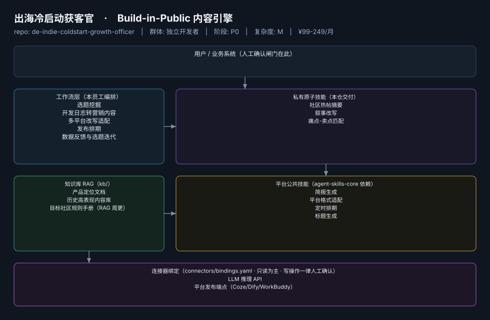

# 出海冷启动获客官

> 产品冷启动期的"增长合伙人"：替你想清楚今天在哪个社区、对谁、说什么话
>
> **Build-in-Public 内容引擎**　·　独立开发者　·　阶段 P0　·　
> 复杂度 M　·　¥99-249/月　·　定义卡 4.4.1

## 演示（真实执行录播）


*真实执行回放（GIF 自动循环，非摆拍）· [▶ 观看完整版 MP4](workflows/wf-indie-coldstart-log-to-content/docs/images/08-demo-run.mp4) · 台账见 [`reports/real-run/wf-indie-coldstart-log-to-content.md`](reports/real-run/wf-indie-coldstart-log-to-content.md)*



## 效果（真实执行）


*上图为**真实效果对比**，不是示意图：左栏是输入材料与要求，右栏是该次执行的产出原文，
两栏取自同一次真实执行记录。*

- 完整台账：[`reports/real-run/wf-indie-coldstart-log-to-content.md`](reports/real-run/wf-indie-coldstart-log-to-content.md)
- 录屏与终端回放：[`workflows/wf-indie-coldstart-log-to-content/docs/images/`](workflows/wf-indie-coldstart-log-to-content/docs/images/)（`08-demo-run.gif` / `08-demo-run.mp4` / `04-terminal-run.png`）
- 使用示例：[`workflows/wf-indie-coldstart-log-to-content/docs/使用示例.md`](workflows/wf-indie-coldstart-log-to-content/docs/使用示例.md)
> 实测判定：**通过**　·　可用度 4/5　·　编造数字 0 处　·　红线命中 9 次 / 拦截 9 次


**一句话**：冷启动期 3-6 个月的 C 端/PLG 产品独立开发者，尤其中出海方向

---

## 这个数字员工解决什么问题

本章核心论点载体：冷启动增长 Agent 是全市场空白（详见 4.6）。R1 调研明确：市场上没有独立开发者冷启动增长的成品 Agent，最接近的是数千元/月的营销 Agency——独立开发者付不起。该员工为本群体第一优先级产品。

| 项 | 内容 |
|---|---|
| 服务对象 | 冷启动期 3-6 个月的 C 端/PLG 产品独立开发者，尤其中出海方向 |
| 可量化目标 | 周均内容产出 ≥5 条；目标社区（X/Reddit/即刻/小红书）月均曝光与Profile访问环比 +20%；冷启动期官网/产品页月均自然访问增量 |
| 投入产出 | 月省约 45h × ¥80 ≈ ¥3600 vs 订阅成本，回报比 >14 倍 |
| 需求依据 | D28、D01、D11、D22 |
| 分发渠道 | GitHub、小红书、Coze扣子商店、腾讯WorkBuddy Skill市场 |

## 30 秒上手

```bash
git clone <本仓库地址> && cd de-indie-coldstart-growth-officer
pip install pyyaml
python3 tests/run.py            # 先跑一遍自检，确认环境与契约都对得上
```

试用（把 `<输入>` 换成本人真实材料）：

```text
请以「出海冷启动获客官」的身份，帮我跑「选题挖掘」。
材料如下：<输入>
要求：只使用材料里出现过的数字，缺的写 <待填>；对外文案停在待确认状态。
```

详细接入见 [`docs/01-安装与接入.md`](docs/01-安装与接入.md)。

## 仓库结构

```text
de-indie-coldstart-growth-officer/
├── employee.md            # 人读定义卡（12 主字段 + 2 扩展组，由 employee.yaml 生成）
├── employee.yaml          # 机器契约（能力清单 + 依赖锁）
├── dependencies.yaml      # 对 core 的外部依赖（含版本）
├── persona/               # 运行提示词 / 边界 / KPI
├── skills/                # 私有原子技能（3 个）
├── spec-bindings/         # 有意不公共化能力的本地绑定声明（0 个）
├── workflows/             # 本员工工作流（5 条）
├── kb/                    # 知识库 RAG 契约
├── connectors/            # 连接器绑定（只读为主，写操作人工确认）
├── docs/                  # 六类发布文档
└── tests/                 # 自动化多场景测试
```

## 私有原子技能（3）

| 技能 | slug | 复杂度 | 阶段 | 成熟度 |
|---|---|---|---|---|
| `社区热帖摘要` | `community-hotpost-digest` | M | P0 | 已实现 |
| `叙事改写` | `narrative-rewrite` | S | P0 | 契约完备 |
| `痛点-卖点匹配` | `painpoint-sellingpoint-match` | S | P0 | 已实现 |

## 平台公共技能依赖（4）

| 技能 | slug | 全平台复用员工数 |
|---|---|---|
| `简报生成` | `brief-generator` | 10 |
| `平台格式适配` | `platform-format-adapter` | 6 |
| `定时排期` | `scheduled-dispatch` | 6 |
| `标题生成` | `title-generator` | 4 |

> 这些技能来自 `agent-skills-core@1.0.0`，本仓库**只引用不复制**。

## Spec 绑定层（0）

（无）

> 这一族能力**有意不公共化**（与外部平台接口强绑定）。本仓不存正文，
> 只留本地绑定声明与连接器配置。

## 工作流（5）

| 工作流 | slug | 触发 | 阶段 | 调用技能数 |
|---|---|---|---|---|
| `选题挖掘` | `wf-indie-coldstart-topic-mining` | 定时（每日 8:00） | P0 | 2 |
| `开发日志转营销内容` | `wf-indie-coldstart-log-to-content` | 人工（提交 commit 摘要/日志） | P0 | 2 |
| `多平台改写适配` | `wf-indie-coldstart-multichannel` | 事件（主稿确认后） | P0 | 2 |
| `发布排期` | `wf-indie-coldstart-scheduling` | 定时 | P1 | 2 |
| `数据反馈与选题迭代` | `wf-indie-coldstart-review` | 定时（每周） | P1 | 1 |

## 知识库与连接器

- 知识库语料：['产品定位文档', '历史高表现内容库', '目标社区规则手册（RAG 周更）']
- 连接器：LLM 推理 API、平台发布端点（Coze/Dify/WorkBuddy）

## 质量与验收

| 项 | 值 |
|---|---|
| 技能文件数 | 207 |
| 多场景用例数 | 238 |
| 用例通过 | 238 |
| 验收结论 | ✅ 通过 |

完整报告：[`docs/05-验收与测试.md`](docs/05-验收与测试.md)

## 许可

专有许可，详见 [`LICENSE`](LICENSE)。
